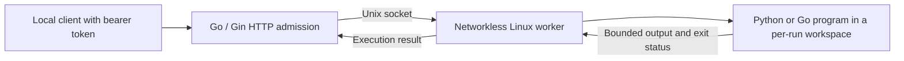

# CodeOS Runtime

CodeOS Runtime is the Go execution service extracted from CodeOS, a programming
learning workbench. It runs Python programs and evaluates Go or Python submissions
against caller-supplied cases. This repository includes the execution service,
Linux worker, loopback Compose setup, and a synthetic end-to-end example.

## Run locally

Use Docker with Linux containers and Docker Compose v2, OpenSSL, and Python 3
to run the example. The build fetches the Go and Python base images and Go modules.

```sh
git clone https://github.com/pllsparrow/codeos-runtime.git
cd codeos-runtime
export CODELAB_JUDGE_TOKEN="$(openssl rand -hex 32)"
docker compose build runner
docker compose up -d --no-build --pull never --wait
python3 examples/smoke.py
docker compose down
```

The example checks readiness, rejection of a request without a token, a Python
Run, and Go submissions with passing and failing cases. The endpoint binds to
`127.0.0.1:18033`. Set `CODEOS_RUNTIME_PORT` in the same shell before startup
and the example to use a different local port.

For source checks with Go 1.26.6 or newer, run `go test -race ./...` and
`go vet ./...`. Docker provides the Linux worker needed for real execution.

## Architecture



- HTTP admission validates the bearer token, request ID and payload before
  acquiring a slot. The default is one admitted request at a time. Saturation
  returns HTTP 503. The caller receives the result within the request lifetime.
- The worker launches programs under a separate UID/GID in per-run workspaces,
  applies time and output bounds and cleans up the process group. Compose
  provides a networkless worker, a read-only root, bounded tmpfs, CPU, memory
  and process limits. Use the loopback setup for trusted local evaluation.
- Go submissions compile once and run each case in a fresh workspace. Submit
  reports how many cases passed and the first failure. Run returns stdout,
  stderr and the execution status.
- The `Idempotency-Key` header correlates a request with its response.
  Execution is request-scoped and has no durable queue or deduplication store.

## Scope

This release covers the Runner component. The Notebook UI, learning persistence,
Mentor and the full CodeOS installation are part of the broader workbench. This
Compose profile is single-user and supports local execution. A public
multi-tenant deployment requires its own reviewed execution and access model.

The export contains selected original source files, their Go module lock
metadata, the existing unit tests, and a local synthetic example. Go dependencies
and Docker base images are fetched at build time and retain their own licenses.

## License

Original project source is available under the [MIT License](LICENSE).
