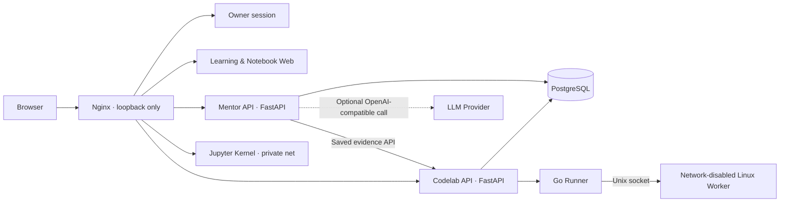

# CodeOS — Self-Hosted Programming Learning Workbench & Isolated Execution Runtime

CodeOS combines a **self-hosted programming learning platform** (Courses, Knowledge, Notes,
Python Notebook Lab, and optional AI evidence review) with a **network-disabled Go code
execution sandbox** in one repository.

- **Live Guest Site (Account-Free)**: [pllsparrow.github.io/codeos-runtime](https://pllsparrow.github.io/codeos-runtime/)
- **License**: [MIT](LICENSE) (see [Third-Party Notices](THIRD_PARTY_NOTICES.md))

---

## What's Inside

1. **Public Guest Demo (`docs/`)**: Static, account-free learning showcase with curated
   articles and static-replay Python micro-experiments (hosted on GitHub Pages).
2. **Self-Hosted Learning Workbench (`deploy/learning-release/`, `apps/`, `backend/`, `frontend/`)**:
   - **Courses & Knowledge**: Clean read-only learning surfaces separated from authoring.
   - **PostgreSQL-Authoritative Notes**: Independent writing space with draft/publish
     separation, optimistic revision conflict protection, and Markdown export.
   - **Isolated Python Notebook Lab**: Run Python cells in a network-restricted Jupyter
     kernel, persist code and outputs to PostgreSQL, reopen saved workspaces, and export
     standard `.ipynb` files.
   - **Zero-API-Key Core + Optional Mentor AI**: Core learning and Notebook workflows work
     completely without LLM credentials; optionally configure any OpenAI-compatible provider
     (such as Google AI Studio / Gemini) to review saved Notebook runs and Notes.
3. **Standalone Go Execution Sandbox (root `*.go`, `cmd/`, `compose.yml`)**:
   - Isolated HTTP runner + network-disabled Linux worker over a Unix domain socket.
   - Enforces concurrency admission, timeouts, process-group cancellation cleanup, and
     bounded output limits for Python and Go execution.

---

## Architecture



PostgreSQL, the Jupyter kernel, and the Go Runner/Worker stay on internal container networks
or a local Unix socket. Executed user code never receives database credentials, application
secrets, or host filesystem access.

---

## Option 1: Run the Full Learning Workbench (Docker)

Requires **Docker (Compose v2)** and **Python 3.12+**:

```sh
python3 deploy/learning-release/init.py
deploy/learning-release/learning up --build -d
```

Open `http://127.0.0.1:18080/` and sign in with the email and password created during
`init.py`. Set `LEARNING_PORT` in `deploy/learning-release/install.env` if port `18080` is
busy.

### Sample Walkthrough

1. Open **Python Experiments → Shared nested lists**, read the lesson, and add a linked note
   in **Notes**.
2. Open **Experiment** to launch the Python Notebook, run the cell, change
   `copy[0].append(99)` to `copy[0] = [99]`, run again, then save and reopen to verify
   retained code and outputs.
3. *(Optional)* Configure `MENTOR_MODEL_URL`, `MENTOR_MODEL_KEY`, and `MENTOR_MODEL` in
   `deploy/learning-release/install.env`, restart with
   `deploy/learning-release/learning up -d mentor`, and select **Ask Mentor** on a saved run.

---

## Option 2: Run the Standalone Go Execution Sandbox

To evaluate or test only the Go Runner & network-disabled Linux Worker:

```sh
cp .env.example .env
docker compose up --build -d
go test -race ./...
```

See `examples/` for sample Python and Go execution requests.

---

## Operations, Backup & Restore

- **Status & logs**: `deploy/learning-release/learning ps -a` and
  `deploy/learning-release/learning logs --tail 100 setup site`
- **Stop (data retained in named volumes)**: `deploy/learning-release/learning down`
- **Backup**:

  ```sh
  umask 077
  deploy/learning-release/learning exec -T database \
    pg_dump -U learning_admin -Fc codeos_learning > codeos-learning.dump
  ```

- **Restore**: Initialize a fresh database to create scoped roles, stop app services, restore
  with `pg_restore --clean --if-exists --exit-on-error`, and restart.
