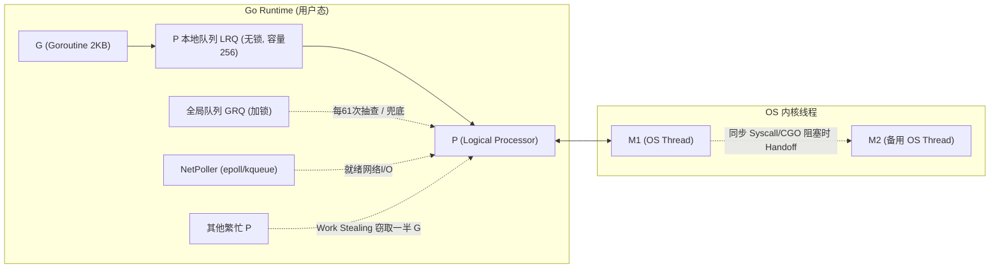

# 操作系统进程、线程、协程与 Go Worker 并发实战

> 核心主线：从 Linux 内核统一任务模型出发，打通「内存隔离与切换开销 → Go GMP 调度 → 有界 Worker 任务认领与防脏写 → Context 取消与进程树清理」的完整因果链路，并对照 `codeos-runtime` 隔离执行沙箱的真实工程落地。

---

## 一、进程、线程与用户态协程的本质区别

### 1. Linux 统一任务模型与隔离边界

Linux 内核并不严格区分「进程」与「线程」，二者在内核中都以 `task_struct` 描述，底层统一通过 `clone(2)` 系统调用创建。真正的差别在于传入的标志位是否共享资源：

- `CLONE_VM`：是否共享虚拟地址空间（页表 `mm_struct`）
- `CLONE_FILES`：是否共享文件描述符表（FD Table）
- `CLONE_SIGHAND`：是否共享信号处理表

| 维度 | 进程（Process） | 线程（Thread） | 协程（Coroutine / Goroutine） |
| :--- | :--- | :--- | :--- |
| **定位** | 资源分配最小单位 | CPU 调度最小单位 | 用户态轻量级执行流 |
| **地址空间** | 独立页表（硬件级强隔离） | 共享所属进程堆与 FD | 共享所属进程堆与 FD |
| **默认栈大小** | 进程级独立内存空间 | 通常 2MB–8MB 固定栈 | Go 初始 2KB，按需动态扩缩 |
| **调度者** | OS 内核调度器 | OS 内核调度器 | 语言 Runtime（用户态，内核无感知） |
| **典型切换开销** | 微秒级 + TLB/Cache 抖动 | 微秒级（陷入内核态） | 纳秒级（纯用户态切少量寄存器） |
| **崩溃影响域** | 仅自身退出，不影响兄弟进程 | 未捕获错误拖垮整个进程 | 未捕获 `panic` 直接拖垮整个进程 |

### 2. 上下文切换（Context Switch）的隐性成本链路

- **跨进程切换**：陷入内核态 → 保存/恢复通用寄存器与内核栈 → 重载页表基址寄存器（x86 `CR3`）→ 触发 **TLB Flush（快表刷新）** 与页表遍历（Page Table Walk）→ **L1/L2/L3 CPU Cache 大面积失效（Cache Miss）**。直接开销在微秒级，真正昂贵的是切换后的缓存冷启动。
- **同进程线程切换**：不切换 `CR3` 页表（TLB 保留），但仍需要用户态 ↔ 内核态切换与内核调度器介入；多核读写同一缓存行时还容易触发**伪共享（False Sharing）**。
- **用户态协程切换**：完全在用户态保存/恢复少量关键寄存器（如 `SP`、`PC`），无系统调用陷阱、无 TLB 刷新，最大化保留 CPU Cache 局部性。

### 3. 语言并发模型选型对照

- **Python**：受 **GIL（全局解释器锁）** 限制，CPU 密集型走 `multiprocessing`（多进程绕开 GIL），高并发网络 I/O 走 `asyncio`（显式 `async/await` 协程），`threading` 仅适合传统阻塞 I/O。
- **Go**：语言原生内置 Goroutine + GMP 调度器，以同步直观的写法获得异步高并发性能，少量 OS 线程即可承载十万级协程。

---

## 二、Go GMP 调度模型核心机制



### 1. G / M / P 三要素职责

- **G（Goroutine）**：待执行的协程任务，包含动态栈、指令指针与调度状态。
- **M（Machine）**：操作系统内核线程，真正占用 CPU 核执行指令的载体。
- **P（Processor）**：逻辑处理器（默认等于 CPU 核数 `GOMAXPROCS`），持有无锁本地运行队列 **LRQ（容量 256）** 与内存分配缓存（`mcache`）。M 必须绑定 P 才能执行 Go 用户代码。

### 2. `findrunnable()` 查找优先级与 Work Stealing

当 M 绑定的 P 本地队列空闲时，调度器按序查找可运行 G：

1. **P 本地队列（LRQ）**：无锁获取，速度最快（为防全局队列饿死，每调度 61 次会优先抽查一次 GRQ）。
2. **全局队列（GRQ）**：加全局锁批量捞取。
3. **NetPoller（网络轮询器）**：检查 `epoll` / `kqueue` 已就绪的网络 I/O 协程。
4. **Work Stealing（工作窃取）**：随机挑选其他繁忙的 P，从其 LRQ 尾部窃取**一半（n/2）**可运行 G，实现多核负载均衡。

### 3. 阻塞 Syscall / CGO 时的 M-P 交接（Handoff）

- **网络 I/O 阻塞**：通过 Go NetPoller 异步化，G 挂起不阻塞 M，M 立即切换执行其他 G。
- **同步阻塞系统调用（如慢文件 I/O 或 CGO）**：M 被内核卡住，后台监控线程 `sysmon` 发现阻塞后，将 **P 与阻塞中的 M1 解绑（Handoff）**，交给空闲或新建的备用线程 M2 继续消费 LRQ，避免浪费 CPU 核。
- **工程踩坑点**：大量并发 CGO 或慢同步文件 I/O 会导致 M 线程数暴涨（受 `debug.SetMaxThreads` 限制，默认 10000），调度退化为内核多线程竞争。

---

## 三、Go Worker 任务认领与高可靠并发控制

### 1. 为什么协程廉价仍需要有界 Worker Pool

协程栈虽只有 2KB，但无节制 `go func()` 会导致：内存 RSS 飙升（OOM）、下游数据库连接池/RPC 接口被打爆、系统缺乏**背压（Backpressure）**传导机制。生产级并发入口必须具备四个要素：**固定数量 Worker + 有界缓冲 Channel + `context.Context` 取消信号 + `sync.WaitGroup` 优雅停机**。

### 2. 异步任务的认领、超时回收与防脏写（Fencing Token）

在分布式或多 Worker 任务队列中，光靠「查出 `PENDING` 再更新」会导致重复执行和迟到脏写，标准做法是 **Lease（租约）+ 单调递增 Version（Fencing Token）+ CAS 条件更新**：

1. **防重复认领（原子条件更新）**：
   ```sql
   UPDATE tasks
   SET status = 'RUNNING', owner = $1, version = version + 1, lease_until = NOW() + INTERVAL '30 seconds'
   WHERE id = $2 AND status = 'PENDING';
   ```
2. **Worker 崩溃/长 GC 后的超时回收**：
   超过 `lease_until` 未续租时，巡检器或其他 Worker 携带旧版本号条件接管，并将 `version` 再次递增：
   ```sql
   UPDATE tasks
   SET owner = $1, version = version + 1, lease_until = NOW() + INTERVAL '30 seconds'
   WHERE id = $2 AND status = 'RUNNING' AND lease_until <= NOW() AND version = $3;
   ```
3. **迟到结果防覆盖（CAS 条件提交）**：
   Worker 回写最终结果时必须校验认领时拿到的 `version`：
   ```sql
   UPDATE tasks
   SET status = 'DONE', result = $1
   WHERE id = $2 AND version = $3;
   ```
   假死苏醒的旧 Worker 持旧 `version` 提交时影响行数为 `0`，被直接拦截，杜绝静默覆盖最新结果。

---

## 四、Context 超时取消、Linux 进程树清理与四大高频踩坑

### 1. Linux 进程生命周期与子树清理（`Setpgid` + `subreaper`）

- **僵尸进程（Zombie，`Z` 状态）**：子进程已退出但父进程未调用 `wait()` / `waitpid()` 回收退出码，长期残留会耗尽 PID。
- **孤儿进程（Orphan）**：父进程先退出，子进程被 PID 1（`init`/`systemd`）或最近设置了 `PR_SET_CHILD_SUBREAPER` 的祖先进程（**`subreaper`**）领养。
- **进程组（PGID）清理**：在 `codeos-runtime` 这类代码执行沙箱中，用户脚本常通过 `sh -c "sleep 60"` 派生孙进程。仅对直接子进程发 `SIGKILL` 会让孙进程逃逸成为孤儿；必须设置 `Setpgid: true` 建独立进程组，超时后向**负 PGID**（`-pid`）广播强杀整棵进程树，并结合 `subreaper` 兜底回收。

### 2. 四大高频并发踩坑对照

#### 坑点 1：跨 Goroutine 捕获 Panic 失效

- **错误写法**：在主协程写 `defer recover()` 试图兜底子协程——子协程 `panic` 会直接触发 `runtime.fatalpanic` 杀掉整个进程。
- **正确写法**：在每个 Worker 协程入口内部独立封装 `defer recover()`，记录堆栈并转为普通 `error`，保证单任务失败不拖垮服务。

#### 坑点 2：无界派发 Goroutine 引发雪崩

- **错误写法**：遍历海量任务直接 `go handle(job)`，突发流量瞬间打爆内存与下游连接池。
- **正确写法**：固定数量 Worker Pool + `select { case jobs <- job: case <-ctx.Done(): }`，兼顾并发上限、背压和取消防死锁。

#### 坑点 3：`exec.CommandContext` 超时残留孤儿孙进程 / 卡死管道

- **错误写法**：直接 `exec.CommandContext(ctx, "sh", "-c", "sleep 60").Run()`。超时只杀 `sh`，`sleep 60` 被 PID 1 收养并继续持有 stdout 管道，导致父进程 `CombinedOutput()` 卡满 60 秒。
- **正确写法**：设置 `SysProcAttr{Setpgid: true}`；超时后执行 `syscall.Kill(-cmd.Process.Pid, syscall.SIGKILL)` 向负 PGID 广播清理整棵进程树，并确保 `cmd.Wait()` 回收防僵尸进程。

#### 坑点 4：迟到 Worker 盲写覆盖最新结果

- **错误写法**：任务算完直接 `UPDATE result`，假死后苏醒的旧 Worker 覆盖掉新 Worker 已经写好的结果。
- **正确写法**：认领时发放单调递增 Fencing Token（`version`），回写执行 CAS 条件更新，版本过期直接丢弃结果。

---

## 五、后端面试高频追问（6 题精要答法）

1. **为什么跨进程切换比同进程线程切换慢得多？**
   - 两者都要陷入内核态，但跨进程切换必须重载页表基址寄存器（`CR3`），导致 **TLB Flush**（后续每次访存重新走多级页表）与 **L1/L2/L3 Cache 大面积失效**；同进程线程共享页表，保留了 TLB 与大部分缓存热数据。
2. **Go 协程初始栈只有 2KB，为什么生产环境还要用 Worker Pool？**
   - 协程廉价不代表业务资源廉价。无界起协程会放大堆内存与请求上下文占用、瞬间打满下游数据库连接池/文件描述符，且失去背压和优雅停机控制。
3. **如果一个 Goroutine 陷入死循环或长时间阻塞在 CGO，GMP 调度器会发生什么？**
   - 纯 Go 死循环：Go 1.14+ 已引入基于信号的异步抢占（`sysmon` 检测运行超 10ms 发送 `SIGURG`），不会饿死其他 G。
   - 长时间阻塞在 CGO / 同步 Syscall：`sysmon` 会把 P 从阻塞的 M 上剥离（Handoff）交给备用 M；但如果并发 CGO 过多，会持续创建新 OS 线程直到触发 `SetMaxThreads` 上限。
4. **`exec.CommandContext` 超时取消时为什么会「杀不干净」或 `CombinedOutput` 卡死？`Setpgid` 和 `subreaper` 各自解决什么问题？**
   - `CommandContext` 默认只给直接子进程发 `SIGKILL`，孙进程会逃逸并继续占用 stdout/stderr 管道，导致 Go 读取管道直到 EOF 才返回。`Setpgid: true` + `Kill(-pgid, SIGKILL)` 解决同进程组一次性清理；`PR_SET_CHILD_SUBREAPER` 解决更顽固的二次 fork 脱离父进程场景，确保孤儿被执行器自身收养并统一回收，不留僵尸。
5. **如何设计一个防重复认领、Worker 宕机自动恢复、且拦截迟到脏写的异步任务队列？**
   - 三板斧：**原子条件更新抢占（`WHERE status='PENDING'`）+ 租约超时回收（`lease_until`）+ 单调递增版本号 Fencing Token（`WHERE version=?` CAS 校验）**。
6. **主协程的 `defer recover()` 为什么拦不住子协程 `panic`？生产级 Worker 如何处理？**
   - `panic` 沿着当前 Goroutine 的调用栈向上展开，不会跨协程传播到父协程，到达协程栈顶仍未捕获就会终止整个进程。生产级 Worker 必须在每个 `go func()` 入口最外层统一包装 `defer recover()`，打印 `debug.Stack()` 并将异常收敛为结构化 `error` 返回。
